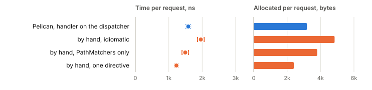
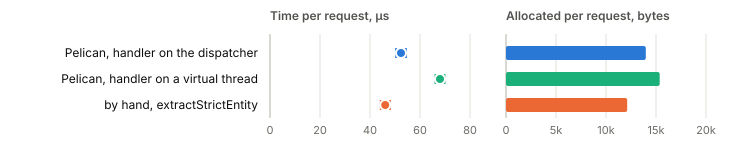
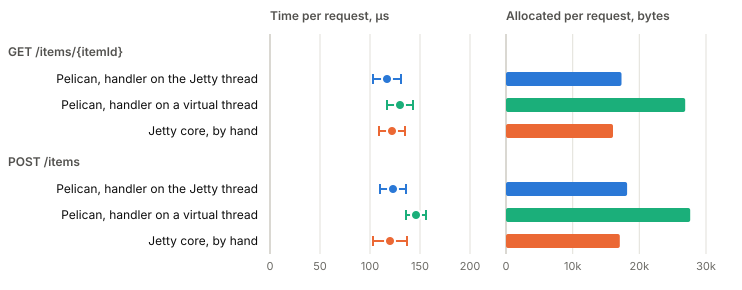
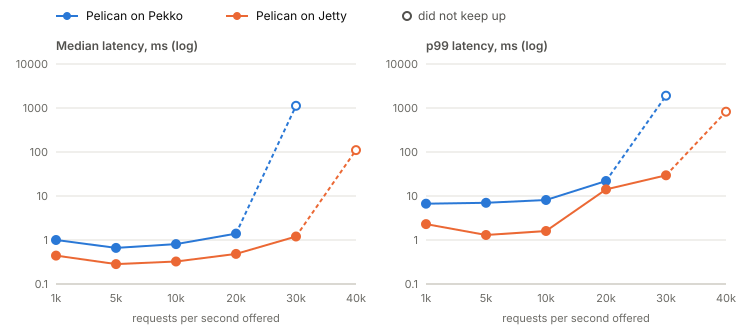
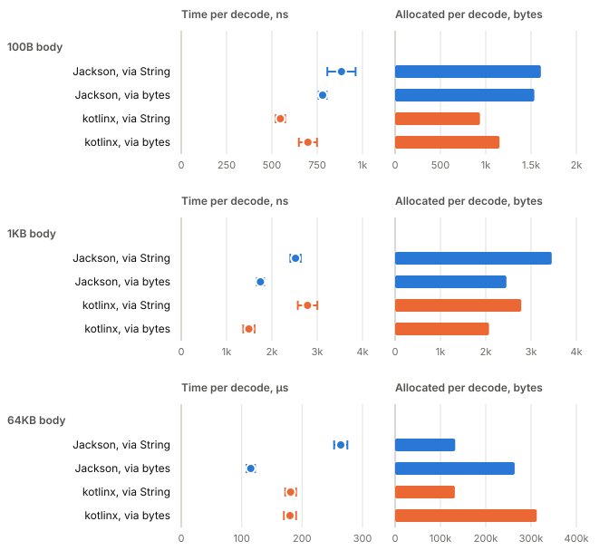

# What it costs

Linked from the [README](../README.md).

A Pelican endpoint is a description, and a backend module interprets it on
every request: it matches the path against the descriptions, decodes the
declared inputs, calls the handler and renders the declared response. This
page measures what that interpretation costs, by running the same endpoint
twice on the same backend: once described with Pelican, once written directly
against the backend's own routing. Both sides decode the same inputs and encode
the same object with the same Jackson mapper, so the difference is the
interpreter.

The measurements are taken with JMH in the [`benchmarks`](../benchmarks)
module, plus one end-to-end run over a socket. They are numbers from one
machine at a time, and the answer differs by backend and by where the handler
runs.

## Contents

- [The short answer](#the-short-answer)
- [How the measurements are taken](#how-the-measurements-are-taken)
- [Pekko, in memory](#pekko-in-memory)
- [Jetty, in memory](#jetty-in-memory)
- [Pekko and Jetty over a socket](#pekko-and-jetty-over-a-socket)
- [Routing as the number of endpoints grows](#routing-as-the-number-of-endpoints-grows)
- [Decoding a body: Jackson and kotlinx](#decoding-a-body-jackson-and-kotlinx)
- [Streaming and framing](#streaming-and-framing)
- [Reproducing these numbers](#reproducing-these-numbers)

## The short answer

- **On Pekko, with the handler on the dispatcher**, Pelican is faster than an
  idiomatic hand-written route, level with one that avoids
  `parameterOptional`, and **356ns and 784 bytes** behind the fastest route
  written by hand. That last figure is the interpreter's cost on this endpoint.
- **On Jetty, with the handler on the Jetty thread**, Pelican and the
  hand-written handler overlap within their error on both a GET and a POST, so
  the interpreter's time is below what this benchmark can resolve. It
  allocates **1.1 to 1.3KB** more per request.
- **Running a synchronous handler on a virtual thread**, which is the default on
  both backends, is the largest cost measured. On Pekko's in-memory GET it is
  about 50 times the dispatcher figure, and the reason has not been
  investigated. On Jetty it adds about 9.5KB of allocation per request. A
  handler that never blocks can opt out with `Handlers.onDispatcher`.
- **On a JSON POST**, Pekko's body handling costs far more than routing does,
  and Pelican on the dispatcher cannot be told apart from the hand-written
  route in time. It allocates 2.0KB more.
- **Routing stays flat** as an API grows from 1 to 200 endpoints, because
  Pelican indexes the path templates instead of trying routes in turn. That
  table was taken on an older machine and an older build and has not been
  retaken.

| Backend | Measurement | Baseline | Principal result | Detail |
|---|---|---|---|---|
| Pekko | in memory, `GET`, JMH | fastest hand-written route | +356ns, +784B | [Pekko](#pekko-in-memory) |
| Pekko | in memory, `GET`, JMH | idiomatic hand-written route | 375ns faster, 1.6KB less | [Pekko](#pekko-in-memory) |
| Pekko | in memory, JSON `POST`, JMH | hand-written `extractStrictEntity` | time within error, +2.0KB | [Pekko](#reading-a-body-on-pekko) |
| Jetty | `LocalConnector`, `GET` and `POST`, JMH | hand-written Jetty core handler | time within error, +1.1 to 1.3KB | [Jetty](#jetty-in-memory) |
| Pekko, Jetty | loopback socket, open-model load | each other, both Pelican | not an overhead measurement; see the section | [Over a socket](#pekko-and-jetty-over-a-socket) |
| Pekko | in memory, 1 to 200 endpoints, JMH | none comparable on `main` | flat at 645 to 713ns | [Routing](#routing-as-the-number-of-endpoints-grows) |

Rows from different sections are not comparable with each other. The Pekko
benchmark hands the route a request that is already an object; the Jetty one
parses and generates HTTP bytes; the socket run measures two whole servers
under load; the routing table comes from a different machine. Each section
says what its own baseline is.

What this page does **not** establish:

- That Pelican is free. It costs hundreds of nanoseconds and some kilobytes on
  the endpoints measured here, and more where a handler is moved onto a
  virtual thread.
- How a service will perform in production. The in-memory benchmarks exclude
  the network on purpose, and the socket run puts its load generator on the
  same four cores as the servers.
- Anything about endpoints shaped very differently from the ones measured: one
  path parameter and one optional query parameter, and a small JSON body.

For scale: the interpreter's own cost on the dispatcher is a few hundred
nanoseconds. Median request latency in the
[socket run](#pekko-and-jetty-over-a-socket), at the rates both servers
sustained, was 283µs to 1.4ms, and a database call typically takes
milliseconds. At that scale it is a small fraction
of a request. The virtual-thread handoff measured on Pekko, about 77µs in
memory, is not small at that scale, which is why it is called out above. The
per-request work is the bag of decoded values, the `Params` around it and the
response. None of the benchmarks here vary the number of declared inputs, so
how the cost changes with them is not measured.

## How the measurements are taken

### The harness

Each benchmark is a JMH class in `benchmarks/src/main/kotlin`. The `jmh` task
runs them with JMH 1.37, reporting average time per operation. Unless a
section says otherwise, every benchmark uses the same settings, declared on
the class:

- **Three forks**, each a fresh JVM. A JIT decision can go one of two ways per
  process, and only separate JVMs show it: a benchmark can settle at one speed
  in one fork and a markedly different one in another, each flat across its
  iterations. A single-JVM timing loop cannot see that, and one that times two
  handlers in the same JVM, off the same warmed profile, can report a
  difference of zero that separate forks do not reproduce.
- **Five one-second warmup iterations and five one-second measured
  iterations** per fork, so fifteen measured iterations in all.
- **Errors are JMH's 99.9% confidence interval** over those fifteen
  iterations. Where two rows' intervals overlap, this page says the
  difference is not resolved rather than reporting the gap between the means.
- **Allocation is `-prof gc`'s `gc.alloc.rate.norm`**, bytes per operation,
  which the task always passes. It counts every thread rather than only the
  caller, and unlike time it barely varies from run to run, so it is often the
  steadier of the two results.
- **A pinned 512MB heap** per fork. These handlers allocate three or four
  gigabytes a second and keep none of it. With the default heap ceiling, a
  quarter of the machine's RAM, the young generation grew until its pages
  stopped being resident, and on a workstation with an IDE open the benchmark
  reported 491µs for a 14µs operation before the heap was pinned.
- **Every benchmark returns its response**, which is how JMH knows the work was
  not dead code. A handler whose result went unused could be optimised away.

In the charts on this page, a dot is the mean and its whiskers are the
99.9% interval, so where two rows' whiskers overlap the difference is not
resolved. Allocation is drawn as a bar, because its error is a few bytes.
Each chart is drawn from the table above it by
[`what-it-costs.py`](assets/what-it-costs.py), and the tables remain the
exact figures.

The benchmarks are not tests and nothing runs them as part of `check` or
`build`. That keeps the coverage agent out of them: instrumentation rewrites
more of Pelican than of a hand-written route, which is exactly the comparison
being made, so a measurement taken through the agent reports the agent.

The in-memory benchmarks have no socket, no connection handling and no OS
scheduling of network I/O. That flatters both sides equally and isolates the
layer under test; the [socket run](#pekko-and-jetty-over-a-socket) is the
complement.

### The machines

Two machines appear on this page, and their numbers are never compared with
each other.

- **The cloud instance**, which took the Pekko, Jetty, decode and socket
  measurements, in October 2026. An Intel Xeon at 2.80GHz,
  4 cores (one thread each), 16GB, Ubuntu 24.04.5 LTS, Linux 6.18.44 in a
  Firecracker microVM. The benchmarks ran on JDK 25.0.4.1, the toolchain
  `benchmarks/build.gradle.kts` names; Gradle itself ran on OpenJDK 21.0.12.
  Pekko 1.7.1, Pekko HTTP 1.4.1, Jetty 12.1.13.
- **An Apple M3** (four performance and four efficiency cores), 24GB, macOS
  26.5.2, on Temurin 21.0.9+10, which took the routing-scale table in August
  2026. It has not been retaken.

Every current table ran on JDK 25, where `Handlers.default` is virtual
threads, so "the default" on this page means virtual threads. Below JDK 24 the
default is a pool of platform threads, which none of these benchmarks
measures.

### A quiet machine matters

A benchmark is only as quiet as the machine under it. The M3 tables were taken
on an otherwise idle machine. The cloud instance had nothing else running, but
its load average was about 2 during the JMH runs (JMH's own threads) and much
higher during and just after the socket run, where the driver is part of the
load. Each section gives the load average it saw.

The same command on the same laptop, with an IDE indexing a fresh module and
eight gigabytes of swap in use, once reported two to five times these figures
with error bars to match, and one row at thirty-five times. If a result comes
back with an error close to its own size, that is the machine talking, and the
run is worth repeating rather than reading.

## Pekko, in memory

**What is measured.** One endpoint, `GET /items/{itemId}?limit=`, answering
JSON, plus a JSON `POST /items`. Every route is sealed and called with
`Route.function(system)`, so none of them pays for a socket; this is the same
choice the in-memory transport in `pelican-test-pekko` makes.

**The comparison.** Three hand-written Pekko routes for the GET, because one
alone gives the wrong impression:

- *idiomatic*: `PathMatchers` and `parameterOptional`, the way the Pekko
  documentation writes it;
- *matchers only*: `PathMatchers`, with the query read off the request;
- *one directive*: a single `extractRequest` that matches the path and reads
  the query itself, which is what Pelican's interpreter does.

Pelican is measured twice: with `toRoute(system, Handlers.onDispatcher)`, which
runs the synchronous handler on Pekko's dispatcher as the hand-written routes
do, and on a virtual thread, which is what `toRoute` does by default.

`./gradlew :benchmarks:jmh -PbenchmarkArgs="PekkoOverhead"`, on the cloud
instance, with the shared settings. The run took about six minutes. The load
average was 9.85 when it started, left over from the socket run before it, and
2.06 when it ended.

| | per request | allocated |
|---|---|---|
| **Pelican, handler on the dispatcher** | **1584 ± 68ns** | **3185 ± 64B** |
| Pelican, handler on a virtual thread (the default) | 78,499 ± 3352ns | 14,028 ± 116B |
| Pekko, idiomatic (`PathMatchers` + `parameterOptional`) | 1959 ± 99ns | 4841 ± 3B |
| Pekko, `PathMatchers` with the query read off the request | 1492 ± 96ns | 3801 ± 2B |
| Pekko, one directive and both read off the request | 1228 ± 54ns | 2401 ± 2B |

<picture>
  <source media="(prefers-color-scheme: dark)" srcset="assets/what-it-costs/pekko-get-dark.svg">
  
</picture>

The virtual-thread row is left out of the chart: at 78µs it is fifty times
the others and would flatten them.

**What it shows.**

- Against the idiomatic route, Pelican on the dispatcher is **375ns and 1.6KB
  cheaper**. That says more about `parameterOptional` than about Pelican: the
  idiomatic row and the one below it put that one directive at about 470ns and
  a kilobyte.
- Against the matchers-only route, the two are 92ns apart, inside the sum of
  their errors, so the time difference is not resolved. Pelican allocates 616
  bytes less.
- Against the single-directive route, the hand-written version is **356ns and
  784 bytes ahead**, clear of both errors. This is the interpreter's cost on
  this endpoint.
- On a virtual thread the same request takes about 50 times as long and
  allocates 10.8KB more.

**Limitations.**

- The virtual-thread gap is far larger than the extra allocation would
  explain, and I have not looked into where the time goes. This machine has
  four cores to hand a request between; a machine with more may show a smaller
  gap. Treat the figure as measured but unexplained.
- The run started on a machine still busy from the socket benchmark. The
  intervals are tight, but a retake on an idle machine would be the cleaner
  number.
- One endpoint shape. Endpoints with more inputs, or larger responses, are not
  measured.

### Reading a body on Pekko

The GET above never materialises a stream: the request has no entity and the
response is strict. A JSON `POST /items` is where Pekko's streams actually run,
because `toStrict` materialises one. The hand-written baseline uses
`extractStrictEntity`. Same command, machine and run as the GET.

| | per request | allocated |
|---|---|---|
| **Pelican, handler on the dispatcher** | **79.8 ± 4.5µs** | **14,247 ± 106B** |
| Pelican, handler on a virtual thread (the default) | 105.1 ± 5.5µs | 15,699 ± 150B |
| Pekko, hand-written `extractStrictEntity` | 97.5 ± 31.3µs | 12,234 ± 352B |

<picture>
  <source media="(prefers-color-scheme: dark)" srcset="assets/what-it-costs/pekko-post-dark.svg">
  
</picture>

**What it shows.** A body costs two orders of magnitude more than routing does
on this backend. Pelican on the dispatcher allocates 2.0KB more than the
hand-written route, and its time cannot be told apart from it: the
hand-written row's error of 31µs covers the difference, so the lower mean is
not evidence that Pelican is faster. Pelican on a virtual thread is clearly
slower than Pelican on the dispatcher, by about 25µs; against the hand-written
route it overlaps.

**Limitations.** The hand-written row's wide interval makes this the least
precise comparison on the page. The interpreter keeps a second way of reading a
body for chunked uploads, which this benchmark does not exercise; see
[`ChunkedBodyLimitTest`](../backends/pekko/pelican-pekko/src/test/kotlin/io/github/matthewjones372/pelican/pekko/ChunkedBodyLimitTest.kt)
for why it exists.

## Jetty, in memory

**What is measured.** The same GET and the same JSON POST, served by
`toHandler` on a started Jetty `Server` with `PELICAN_URI_COMPLIANCE`, with
every request sent through a `LocalConnector`.

**The comparison.** A `Handler.Abstract` written against Jetty 12 core that
matches the path, reads the query with `Request.extractQueryParameters`, reads
the body with `Content.Source.asByteArrayAsync` and writes the same Jackson
bytes, on its own started `Server`. Pelican is measured with the handler on the
Jetty thread (`Handlers.onDispatcher`) and on a virtual thread, the default.

**Why these numbers do not compare with Pekko's.** A `LocalConnector` has no
socket, but it is a real connector: each request arrives as bytes, is parsed as
HTTP/1.1 on Jetty's thread pool, and its response is generated back into bytes
that the caller waits for. Pekko's `Route.function` does none of that: it takes
an `HttpRequest` that is already an object and returns one. The Jetty rows
include a parse, a generate and two thread handoffs per request. They say what
Pelican costs on Jetty against Jetty by hand, and nothing about which server is
faster.

`./gradlew :benchmarks:jmh -PbenchmarkArgs="JettyOverhead DecodeBenchmark"`,
on the cloud instance, with the shared settings. The run took about ten
minutes, with a load average of 2.06 at the start and 2.37 at the end.

| | per request | allocated |
|---|---|---|
| **Pelican on Jetty, handler on the Jetty thread** | **117 ± 14µs** | **17,330 ± 78B** |
| Pelican on Jetty, handler on a virtual thread (the default) | 130 ± 13µs | 26,883 ± 265B |
| Jetty core, hand-written | 122 ± 13µs | 16,047 ± 69B |
| **Pelican, `POST /items`, on the Jetty thread** | **123 ± 13µs** | **18,158 ± 137B** |
| Pelican, `POST /items`, on a virtual thread | 146 ± 10µs | 27,635 ± 175B |
| Jetty core, hand-written `POST /items` | 120 ± 17µs | 17,076 ± 86B |

<picture>
  <source media="(prefers-color-scheme: dark)" srcset="assets/what-it-costs/jetty-dark.svg">
  
</picture>

**What it shows.**

- On both requests, Pelican on the Jetty thread and the hand-written handler
  overlap within their error. Most of each figure is the connector's thread
  handoffs, which both pay alike, so the interpreter's own time is below what
  this benchmark can resolve.
- Allocation is the steadier result. Pelican on the Jetty thread allocates
  **1283 bytes** more than Jetty by hand on the GET and **1082 bytes** more on
  the POST.
- A virtual thread adds about **9.5KB** a request on both. On the POST it is
  also the one row whose time sits above the others: about 26µs over the
  hand-written handler and 23µs over Pelican on the Jetty thread, at the edge
  of the errors. On the GET its time overlaps.

**Limitations.** With most of the time spent in the connector, a regression in
the interpreter of a few hundred nanoseconds would not show here. A benchmark
that calls Jetty's handler without the connector would be needed to resolve
the time difference, and none exists yet.

## Pekko and Jetty over a socket

**What is measured.** Two whole servers under load: Pelican on Pekko and
Pelican on Jetty, each started through its own `start()` with its defaults,
each in a JVM of its own with a 1GB heap, driven in turn over loopback with the
same GET and JSON POST as the tables above, alternating. The defaults matter:
synchronous handlers run on a virtual thread per request on both. Jetty uses
its `QueuedThreadPool` of 200 with virtual threads for handlers; Pekko uses its
default dispatcher.

**The comparison.** The two servers against each other. **Both are Pelican,
so this is not a measurement of the interpreter's overhead.** It answers the
question the in-memory tables cannot: with HTTP parsing, sockets and
scheduling included on both, how do the two backends behave under a rising
request rate?

**The driver.** The load is open-model: requests leave on a fixed schedule
whether or not earlier ones have answered, and each request's latency is
measured from when it should have left, so a stall shows in every request
queued behind it. The driver runs on Jetty's `HttpClient` with at most 256
requests in flight; the JDK's client was tried first and fell behind its own
schedule at 20,000 to 40,000 requests a second, at which point it was
measuring itself. Each server is warmed for 30 seconds at 5,000 requests a
second, then each rate runs for 5 seconds unrecorded and 15 recorded. A server
stops keeping up at the first rate whose p99 reaches 100ms, that loses more
than 0.1% of its requests, or whose senders fall two seconds behind.

`./gradlew :benchmarks:wire` on the cloud instance, taking 5m 58s. **The
driver and both servers shared the same four cores**, so each ceiling below
belongs to the pair of driver and server, not to the server alone. The machine
was idle at the start (load average 0.25 one minute after boot). The load
average was 1.70 before Pekko's warmup and 14.17 after its last rate; Jetty
started at 13.28, most of which is Pekko's run because the average lags, and
ended at 10.70.

| server | req/s | p50 | p99 | p99.9 | max | requests | errors | kept up |
|---|---|---|---|---|---|---|---|---|
| pekko | 1000 | 1.0ms | 6.7ms | 50.3ms | 64.1ms | 15000 | 0 | yes |
| pekko | 5000 | 663µs | 7.0ms | 22.9ms | 31.8ms | 75000 | 0 | yes |
| pekko | 10000 | 807µs | 8.1ms | 29.2ms | 40.2ms | 150000 | 0 | yes |
| pekko | 20000 | 1.4ms | 21.9ms | 45.7ms | 76.3ms | 300000 | 0 | yes |
| pekko | 30000 | 1124.1ms | 1908.4ms | 1950.4ms | 2000.7ms | 338323 | 0 | no |
| jetty | 1000 | 442µs | 2.3ms | 9.7ms | 21.0ms | 15000 | 0 | yes |
| jetty | 5000 | 283µs | 1.3ms | 6.1ms | 11.3ms | 75000 | 0 | yes |
| jetty | 10000 | 324µs | 1.6ms | 8.3ms | 14.8ms | 149998 | 0 | yes |
| jetty | 20000 | 482µs | 14.1ms | 40.7ms | 62.7ms | 299999 | 0 | yes |
| jetty | 30000 | 1.2ms | 29.6ms | 53.7ms | 85.9ms | 450000 | 0 | yes |
| jetty | 40000 | 110.7ms | 825.8ms | 846.2ms | 862.5ms | 600000 | 0 | no |

<picture>
  <source media="(prefers-color-scheme: dark)" srcset="assets/what-it-costs/socket-dark.svg">
  
</picture>

Both lines are Pelican, so the chart compares the backends, not Pelican with
hand-written code. The latency axis is logarithmic.

`requests` counts the recorded requests over 15 seconds. Pekko at 30,000 sent
338,323 of the 450,000 it was due to, because its senders fell more than two
seconds behind schedule, so that step stopped early.

**What it shows.**

- On this machine, with this driver, Pekko's last rate that kept up was 20,000
  requests a second and Jetty's was 30,000. Both failed by the senders falling
  behind, not by errors.
- At the rates both sustained, Jetty's latencies were lower. From 1,000 to
  10,000 requests a second, p99 was 1.3 to 2.3ms on Jetty against 6.7 to 8.1ms
  on Pekko, p99.9 was 6 to 10ms against 23 to 50ms, and the median at 5,000
  and 10,000 was 283 to 324µs against 663 to 807µs.
- At 20,000 the gap narrows (p99 14.1ms against 21.9ms, p99.9 40.7ms against
  45.7ms): both are close to their limit on four shared cores.

**Limitations.**

- This is one run per server, in a fixed order with Pekko first. It is no
  evidence about run-to-run variation, and says nothing about whether a second
  run would put the ceilings in the same place.
- The driver competes with the server for the same four cores, and the load
  average shows it. A ceiling here is not a server's capacity, and neither
  figure is a production throughput.
- Both servers' 1,000 requests a second row has a higher p99.9 than their
  5,000 row. That has not been explained; the first step after the warmup may
  still be warming.
- Both servers run handlers on virtual threads, the default. Given what the
  in-memory Pekko table shows for virtual threads, some of Pekko's latency may
  be that handoff rather than Pekko itself, but this run does not separate the
  two.

### Measuring a change

`-PwireAb=<ref>` compares two builds on one machine. The current checkout is
A. `<ref>` is checked out as a worktree under `benchmarks/build/wire-ab`, this
checkout's `WireServer.kt` is copied into it so that only the libraries
differ, and it is built by its own Gradle as B. Jetty from each then climbs
the same ladder in turn, A then B, for three rounds (ABABAB), and
`benchmarks/build/wire-ab.md` gives, per rate and percentile, each side's
median and range over its rounds, B against A, and whether the two ranges are
disjoint. Overlapping ranges mean the difference is inside run-to-run noise.

`-PwireScenario=stream` swaps the GET and POST for two streamed responses of
100 frames of about 40 bytes, one NDJSON and one SSE, alternating, timed to
the last byte and counted in responses a second. `-PwireScenario=async`
alternates a GET whose handler returns a completed stage with a GET to a path
nothing routes, answered 404: the requests Jetty can answer without leaving its
selector. `both` runs each scenario in turn.

```bash
git fetch origin
./gradlew :benchmarks:wire -PwireAb=origin/main -PwireScenario=both  # on main: the noise, about 35 to 45 minutes
./gradlew :benchmarks:wire -PwireAb=origin/main -PwireScenario=rest  # on a branch: the JSON GET and POST, about 17 minutes
./gradlew :benchmarks:wire -PwireAb=origin/main -PwireScenario=stream  # on a branch: the streams, about 15 to 25 minutes
./gradlew :benchmarks:wire -PwireAb=origin/main -PwireScenario=async  # on a branch: the staged GET and the 404
./gradlew :benchmarks:wire -PwireAb=origin/main -PwireSmoke  # one round, one short step: checks the setup in a minute
```

`-PwireRounds=<n>` changes the three rounds and `-PwireAbPekko` adds Pekko.
The first A/B run also builds the baseline, a few minutes more.

**Main against main.** `origin/main` as A and as B, three rounds each, run on
the cloud instance with nothing else running. Any difference below that is
inside these ranges is noise on this machine.

```bash
./gradlew :benchmarks:wire -PwireAb=origin/main -PwireScenario=both
```

The machine: 4 cores, Intel Xeon @ 2.10GHz, one thread per core, 16 GB, no
swap, Ubuntu 24.04.5 LTS, a Linux 6.18.44 Firecracker VM, JDK 25.0.4.1+1-LTS
for the benchmark and JDK 21 for Gradle. Load averages were 0.00, 0.00, 0.00 on
the freshly booted machine before the run and 4.72, 4.05, 4.05 after it (the
run took about 55 minutes). During the run the load generator and server share
the four cores, so the per-run loads in the file were 6 to 11.

**Reading it.** At the middle rates the medians of identical builds agree on
p50 to within about 4%, but p99 moves by 7% to 21% and p99.9 by 20% to 50%
between sides, and a single side's own p99 range is often 2x to 5x wide. A
result on this machine is therefore trusted only when the two ranges are
disjoint and the gap is large: roughly 5% on p50, and a factor of 2 or more on
p99 and p99.9. The highest sustained rate moved one step on the JSON scenario
(B failed to keep up at 50000 req/s in one round of three, so its highest sustained rate there was 40000),
so one rung of the ladder is also noise. Across the whole table only 2 of 48
rows came out "outside the spread" with identical builds.

#### Rest (JSON GET and POST)

Highest sustained req/s: A 50000 (runs: 50000, 50000, 50000), B 50000 (runs: 50000, 50000, 40000).

| req/s | percentile | A median | A range | B median | B range | B vs A | outside the spread |
|---|---|---|---|---|---|---|---|
| 1000 | p50 | 508µs | 490µs to 515µs | 528µs | 478µs to 530µs | +3.8% | no |
| 1000 | p99 | 2.6ms | 1.7ms to 8.4ms | 3.1ms | 3.0ms to 7.2ms | +18.7% | no |
| 1000 | p99.9 | 7.4ms | 3.8ms to 73.6ms | 23.5ms | 7.2ms to 84.7ms | +217.2% | no |
| 5000 | p50 | 204µs | 199µs to 215µs | 198µs | 188µs to 207µs | -2.8% | no |
| 5000 | p99 | 978µs | 629µs to 1.2ms | 1.1ms | 917µs to 1.2ms | +13.0% | no |
| 5000 | p99.9 | 3.8ms | 3.7ms to 6.2ms | 5.7ms | 5.5ms to 6.4ms | +49.6% | no |
| 10000 | p50 | 215µs | 210µs to 217µs | 213µs | 199µs to 217µs | -0.8% | no |
| 10000 | p99 | 1.7ms | 1.4ms to 3.2ms | 1.5ms | 1.4ms to 3.2ms | -11.9% | no |
| 10000 | p99.9 | 7.8ms | 7.5ms to 53.9ms | 10.5ms | 7.8ms to 26.7ms | +34.7% | no |
| 20000 | p50 | 268µs | 267µs to 276µs | 271µs | 265µs to 277µs | +1.3% | no |
| 20000 | p99 | 6.2ms | 3.3ms to 7.1ms | 5.7ms | 4.9ms to 6.1ms | -7.4% | no |
| 20000 | p99.9 | 26.0ms | 12.2ms to 30.9ms | 20.5ms | 14.7ms to 40.0ms | -21.3% | no |
| 30000 | p50 | 357µs | 336µs to 386µs | 354µs | 319µs to 380µs | -0.7% | no |
| 30000 | p99 | 8.3ms | 7.8ms to 10.2ms | 10.0ms | 7.0ms to 13.5ms | +21.1% | no |
| 30000 | p99.9 | 20.6ms | 19.6ms to 20.6ms | 28.3ms | 16.2ms to 38.9ms | +37.8% | no |
| 40000 | p50 | 721µs | 611µs to 762µs | 608µs | 536µs to 1.0ms | -15.8% | no |
| 40000 | p99 | 10.5ms | 9.2ms to 11.6ms | 9.4ms | 8.9ms to 12.8ms | -10.0% | no |
| 40000 | p99.9 | 17.0ms | 16.9ms to 23.2ms | 20.1ms | 16.9ms to 25.9ms | +18.0% | no |
| 50000 | p50 | 3.1ms | 3.0ms to 4.8ms | 2.7ms | 2.7ms to 11.5ms | -10.1% | no |
| 50000 | p99 | 57.4ms | 27.8ms to 60.5ms | 53.4ms | 37.1ms to 280.2ms | -7.0% | no |
| 50000 | p99.9 | 86.8ms | 48.6ms to 87.8ms | 73.7ms | 49.0ms to 308.0ms | -15.0% | no |
| 60000 | p50 | 1241.5ms | 1224.7ms to 1461.7ms | 988.8ms | 888.1ms to 1089.5ms | -20.4% | yes, faster |
| 60000 | p99 | 1922.0ms | 1916.8ms to 1954.5ms | 1902.1ms | 1839.2ms to 1965.0ms | -1.0% | no |
| 60000 | p99.9 | 1991.2ms | 1978.7ms to 1995.4ms | 1960.3ms | 1929.4ms to 1991.2ms | -1.6% | no |

#### Stream (NDJSON and SSE)

Highest sustained responses/s: A 4000 (runs: 4000, 4000, 4000), B 4000 (runs: 4000, 4000, 4000).

| responses/s | percentile | A median | A range | B median | B range | B vs A | outside the spread |
|---|---|---|---|---|---|---|---|
| 250 | p50 | 994µs | 986µs to 1.0ms | 982µs | 945µs to 1.1ms | -1.2% | no |
| 250 | p99 | 4.5ms | 4.4ms to 5.4ms | 4.2ms | 4.0ms to 6.8ms | -7.1% | no |
| 250 | p99.9 | 10.3ms | 9.7ms to 43.1ms | 25.3ms | 24.4ms to 29.4ms | +145.7% | no |
| 500 | p50 | 869µs | 855µs to 906µs | 892µs | 889µs to 966µs | +2.7% | no |
| 500 | p99 | 3.5ms | 3.2ms to 4.3ms | 6.1ms | 4.0ms to 7.5ms | +73.6% | no |
| 500 | p99.9 | 10.1ms | 7.5ms to 148.6ms | 45.0ms | 40.2ms to 54.5ms | +344.3% | no |
| 1000 | p50 | 824µs | 797µs to 855µs | 779µs | 755µs to 814µs | -5.5% | no |
| 1000 | p99 | 80.1ms | 4.4ms to 93.2ms | 3.7ms | 2.6ms to 4.5ms | -95.4% | no |
| 1000 | p99.9 | 159.3ms | 40.4ms to 208.0ms | 9.1ms | 6.5ms to 15.1ms | -94.3% | yes, faster |
| 2000 | p50 | 717µs | 696µs to 738µs | 753µs | 664µs to 775µs | +4.9% | no |
| 2000 | p99 | 6.7ms | 4.0ms to 9.0ms | 4.2ms | 3.8ms to 4.4ms | -37.8% | no |
| 2000 | p99.9 | 23.9ms | 12.3ms to 53.7ms | 11.6ms | 11.3ms to 15.0ms | -51.6% | no |
| 3000 | p50 | 851µs | 762µs to 982µs | 786µs | 715µs to 905µs | -7.6% | no |
| 3000 | p99 | 5.4ms | 3.9ms to 7.4ms | 5.1ms | 4.8ms to 6.4ms | -5.9% | no |
| 3000 | p99.9 | 12.0ms | 9.2ms to 15.6ms | 13.5ms | 9.8ms to 46.5ms | +12.3% | no |
| 4000 | p50 | 1.1ms | 1.0ms to 1.2ms | 1.1ms | 942µs to 1.2ms | +5.8% | no |
| 4000 | p99 | 6.8ms | 6.7ms to 9.4ms | 11.5ms | 8.1ms to 25.5ms | +68.6% | no |
| 4000 | p99.9 | 12.5ms | 11.3ms to 27.0ms | 36.7ms | 14.7ms to 73.7ms | +192.9% | no |
| 6000 | p50 | 458.5ms | 41.9ms to 644.3ms | 428.9ms | 40.0ms to 431.0ms | -6.5% | no |
| 6000 | p99 | 1051.7ms | 213.8ms to 1317.0ms | 1234.2ms | 169.9ms to 1432.4ms | +17.3% | no |
| 6000 | p99.9 | 1098.9ms | 260.8ms to 1431.3ms | 1285.6ms | 211.0ms to 1504.7ms | +17.0% | no |

### Non-blocking invocation

**What is measured.** Spec 0085's `spec-0085-nonblocking` branch (A) against
`origin/main` (B), three alternating rounds each, with `-PwireAb`. The change
answers routing, 404 and 405, refusals and handlers that return a stage on
Jetty's selector without a dispatch, and hops synchronous handlers to a virtual
thread. `async` is the path it targets; `rest` is the path it adds a hop to,
run to check for a regression. In the tables, "B vs A" is main relative to this
branch, so a negative number means main had the lower latency.

**Machine.** Intel Xeon at 2.10GHz, 4 cores (`nproc` 4), 15GiB memory, Ubuntu
24.04.5, Linux 6.18.44, JDK 25.0.4.1 for the benchmarks and JDK 21 running Gradle.
Load average before and after each run, one, five and fifteen minutes:

| run | before | after |
|---|---|---|
| async | 0.06, 0.01, 0.00 (booted a minute earlier) | 7.86, 5.14, 3.53 |
| rest | 6.81, 5.01, 3.50 | 10.50, 7.09, 5.35 |

The load climbs during each run because the load generator shares the four
cores with the server, so neither run was on a quiet machine in the sense of
[a quiet machine matters](#a-quiet-machine-matters). The per-round load figures
are in `wire-ab.md`. No main against main run exists yet on this page, so the
spread here is only A against A.

```bash
./gradlew :benchmarks:wire -PwireAb=origin/main -PwireScenario=async
./gradlew :benchmarks:wire -PwireAb=origin/main -PwireScenario=rest
```

**async (a staged GET alternating with a 404).** Highest sustained req/s: A 30000 (runs: 60000, 30000, 30000), B 30000 (runs: 10000, 50000, 30000).

| req/s | percentile | A median | A range | B median | B range | B vs A | outside the spread |
|---|---|---|---|---|---|---|---|
| 1000 | p50 | 419µs | 397µs to 432µs | 477µs | 476µs to 514µs | +13.8% | yes, slower |
| 1000 | p99 | 2.3ms | 1.7ms to 2.7ms | 3.0ms | 2.5ms to 26.3ms | +27.3% | no |
| 1000 | p99.9 | 5.5ms | 4.9ms to 18.2ms | 111.5ms | 16.6ms to 131.7ms | +1931.0% | no |
| 5000 | p50 | 189µs | 185µs to 194µs | 200µs | 198µs to 204µs | +5.8% | yes, slower |
| 5000 | p99 | 1.5ms | 957µs to 1.6ms | 1.0ms | 970µs to 1.1ms | -28.2% | no |
| 5000 | p99.9 | 27.5ms | 5.0ms to 28.2ms | 9.6ms | 5.3ms to 19.4ms | -65.2% | no |
| 10000 | p50 | 155µs | 155µs to 172µs | 202µs | 199µs to 212µs | +30.0% | yes, slower |
| 10000 | p99 | 1.8ms | 625µs to 1.9ms | 941µs | 621µs to 1.7ms | -46.3% | no |
| 10000 | p99.9 | 25.6ms | 4.9ms to 54.6ms | 6.8ms | 6.1ms to 9.6ms | -73.5% | no |
| 20000 | p50 | 181µs | 180µs to 182µs | 252µs | 237µs to 255µs | +38.8% | yes, slower |
| 20000 | p99 | 2.0ms | 1.8ms to 2.2ms | 3.2ms | 3.1ms to 315.1ms | +61.6% | yes, slower |
| 20000 | p99.9 | 10.1ms | 9.3ms to 23.2ms | 12.8ms | 12.6ms to 416.0ms | +27.2% | no |
| 30000 | p50 | 226µs | 223µs to 230µs | 308µs | 296µs to 321µs | +36.6% | yes, slower |
| 30000 | p99 | 4.5ms | 3.5ms to 7.1ms | 9.4ms | 7.9ms to 10.8ms | +107.2% | yes, slower |
| 30000 | p99.9 | 14.5ms | 10.0ms to 15.5ms | 23.9ms | 17.7ms to 30.0ms | +64.1% | yes, slower |
| 40000 | p50 | 473µs | 430µs to 13.9ms | 490µs | 434µs to 545µs | +3.6% | no |
| 40000 | p99 | 241.2ms | 14.5ms to 537.4ms | 184.8ms | 16.5ms to 353.1ms | -23.4% | no |
| 40000 | p99.9 | 267.1ms | 125.9ms to 580.4ms | 215.4ms | 38.5ms to 392.2ms | -19.4% | no |
| 50000 | p50 | 619µs | 619µs to 619µs | 1.6ms | 1.6ms to 1.6ms | +153.8% | one run |
| 50000 | p99 | 10.3ms | 10.3ms to 10.3ms | 36.5ms | 36.5ms to 36.5ms | +253.4% | one run |
| 50000 | p99.9 | 16.2ms | 16.2ms to 16.2ms | 72.3ms | 72.3ms to 72.3ms | +346.3% | one run |
| 60000 | p50 | 4.9ms | 4.9ms to 4.9ms | 563.6ms | 563.6ms to 563.6ms | +11405.0% | one run |
| 60000 | p99 | 44.0ms | 44.0ms to 44.0ms | 1195.4ms | 1195.4ms to 1195.4ms | +2618.3% | one run |
| 60000 | p99.9 | 79.8ms | 79.8ms to 79.8ms | 1214.3ms | 1214.3ms to 1214.3ms | +1422.4% | one run |

**rest (the JSON GET and POST, synchronous handlers).** Highest sustained req/s: A 30000 (runs: 30000, 1000, 40000), B 40000 (runs: 40000, 40000, 40000).

| req/s | percentile | A median | A range | B median | B range | B vs A | outside the spread |
|---|---|---|---|---|---|---|---|
| 1000 | p50 | 514µs | 506µs to 561µs | 521µs | 515µs to 544µs | +1.3% | no |
| 1000 | p99 | 2.4ms | 2.4ms to 2.7ms | 2.7ms | 2.1ms to 3.5ms | +9.0% | no |
| 1000 | p99.9 | 6.2ms | 6.0ms to 36.9ms | 28.9ms | 4.5ms to 41.7ms | +366.2% | no |
| 5000 | p50 | 246µs | 242µs to 282µs | 214µs | 207µs to 234µs | -13.3% | yes, faster |
| 5000 | p99 | 1.4ms | 1.3ms to 669.0ms | 1.0ms | 706µs to 1.6ms | -25.6% | no |
| 5000 | p99.9 | 8.4ms | 5.5ms to 780.7ms | 6.0ms | 3.4ms to 14.0ms | -28.6% | no |
| 10000 | p50 | 245µs | 239µs to 251µs | 228µs | 226µs to 235µs | -6.9% | yes, faster |
| 10000 | p99 | 3.1ms | 2.5ms to 3.6ms | 1.8ms | 1.4ms to 2.0ms | -40.3% | yes, faster |
| 10000 | p99.9 | 20.7ms | 17.2ms to 24.1ms | 8.1ms | 7.9ms to 11.1ms | -60.7% | yes, faster |
| 20000 | p50 | 325µs | 304µs to 346µs | 275µs | 268µs to 277µs | -15.1% | yes, faster |
| 20000 | p99 | 5.0ms | 5.0ms to 5.0ms | 4.0ms | 3.6ms to 4.2ms | -20.1% | yes, faster |
| 20000 | p99.9 | 18.6ms | 16.1ms to 21.0ms | 11.8ms | 11.1ms to 15.2ms | -36.3% | yes, faster |
| 30000 | p50 | 553µs | 476µs to 631µs | 377µs | 337µs to 378µs | -31.9% | yes, faster |
| 30000 | p99 | 11.5ms | 8.9ms to 14.1ms | 10.0ms | 6.5ms to 13.8ms | -13.1% | no |
| 30000 | p99.9 | 21.9ms | 17.4ms to 26.4ms | 47.0ms | 14.3ms to 62.5ms | +114.6% | no |
| 40000 | p50 | 187.1ms | 3.6ms to 370.7ms | 764µs | 736µs to 1.7ms | -99.6% | yes, faster |
| 40000 | p99 | 503.3ms | 98.0ms to 908.6ms | 15.7ms | 15.0ms to 61.6ms | -96.9% | yes, faster |
| 40000 | p99.9 | 542.4ms | 156.9ms to 928.0ms | 42.1ms | 30.1ms to 96.4ms | -92.2% | yes, faster |
| 50000 | p50 | 678.4ms | 678.4ms to 678.4ms | 21.9ms | 16.0ms to 228.7ms | -96.8% | one run |
| 50000 | p99 | 1393.6ms | 1393.6ms to 1393.6ms | 160.7ms | 146.8ms to 558.4ms | -88.5% | one run |
| 50000 | p99.9 | 1427.1ms | 1427.1ms to 1427.1ms | 189.3ms | 173.4ms to 598.7ms | -86.7% | one run |

**Verdict, async.** This branch is faster at the median from 1000 to 30000
requests a second, outside the A-vs-A spread at every one of those rates (main
is 6% to 39% higher). At p99 it is faster only where the ranges are disjoint:
20000 req/s (2.0ms against 3.2ms) and 30000 req/s (4.5ms against 9.4ms). Below
that the p99 and p99.9 ranges overlap, so there is no difference beyond the
spread. The highest sustained rate is 30000 for both, and each side's three runs
ranged widely (A 30000 to 60000, B 10000 to 50000), so the ladder ceiling does
not separate them.

**Verdict, rest.** This branch is slower than main, which is the regression the
hop could cause. Main has the lower median at every rate from 5000 to 40000,
outside the spread at each, and the lower p99 and p99.9 outside the spread at
10000 and 20000 req/s (p99 1.8ms against 3.1ms at 10000, 4.0ms against 5.0ms at
20000). At 1000 req/s there is no difference beyond the spread, and the tail at
30000 overlaps. The highest sustained rate is 30000 for this branch (runs
30000, 1000, 40000) against 40000 for main (40000 in all three), though one of
this branch's runs failed at 5000 and ended its ladder early, so that gap is
the least certain figure here. The synchronous path should not be taken as
improved by this change; it needs a cheaper hop, or a decision that the async
gain is worth it.

## Routing as the number of endpoints grows

**What is measured.** Every other table uses an API of one endpoint, which
measures decoding and rendering and says nothing about matching a request
against many endpoints. `RoutingScaleBenchmark` builds APIs of 1, 50 and 200
endpoints and requests the one declared **last**, the worst case for a router
that tries routes in order, and the one a service acquires by adding endpoints
over time. Each request is a whole request: a path parameter decoded, the
handler run, the response encoded.

**The comparison.** Given a list of opaque handlers, a router can only try them
in turn. Given path templates, Pelican builds a trie once and matches a
request by its segments. Registered with Pekko directly, routes are reduced
with `Directives.concat` into an ordered scan, and the benchmark includes that
hand-written control.

`./gradlew :benchmarks:jmh -PbenchmarkArgs="-f 1 RoutingScale"`, on the
Apple M3, in August 2026.

| endpoints | **Pelican on Pekko** |
|---|---|
| 1 | **713 ± 23ns** |
| 50 | **701 ± 122ns** |
| 200 | **645 ± 28ns** |

**What it shows.** The cost does not grow with the number of endpoints. For
contrast, when Pekko's interpreter registered one route per endpoint and let
`Directives.concat` scan them, the same benchmark measured about 150µs a
request at 200 endpoints. That figure is from the same machine but an older
build, and there is no comparable hand-written control on this page, so read
it as the reason the index exists rather than as a measured comparison.

**Limitations.**

- The hand-written Pekko control is in the benchmark but its numbers are not
  reported here, because it is not comparable: it runs each request through a
  materialised flow, which cost about 23µs on its own when last measured and
  swamps the small end. Pelican's row calls the sealed route directly.
- The decoys are `/resource{n}/{id}`, so every endpoint has a distinct first
  path segment. That is the shape most flattering to an index and least
  flattering to a scan. A service whose endpoints all sit under one prefix,
  such as `/orders`, is not measured.
- Taken on the M3 against the August 2026 interpreter, with `-f 1` (one fork).
  It has not been retaken on the cloud instance, so it cannot be read against
  the Pekko table above. Jetty dispatches through the same index, and is not
  measured here.

## Decoding a body: Jackson and kotlinx

**What is measured.** `DecodeBenchmark` decodes one JSON body of each size with
no route and no server, so only the codec is measured.

**The comparison.** Two routes into each library. "Via String" decodes the
bytes to a `String` first, which is what a codec's `decodeFromString` takes.
"Via bytes" hands the codec the bytes: `JacksonCodecs`' `UTF8StreamJsonParser`,
and `KotlinxCodecs.decodeFrom`'s stream reader.

`./gradlew :benchmarks:jmh -PbenchmarkArgs="JettyOverhead DecodeBenchmark"`, the
same run as the [Jetty table](#jetty-in-memory), with the shared settings.

| body | Jackson, via String | Jackson, via bytes | kotlinx, via String | kotlinx, via bytes |
|---|---|---|---|---|
| 100B | 884 ± 78ns, 1608B | 780 ± 22ns, 1536B | 547 ± 26ns, 936B | 699 ± 50ns, 1152B |
| 1KB | 2521 ± 114ns, 3456B | 1748 ± 80ns, 2456B | 2788 ± 216ns, 2784B | 1493 ± 125ns, 2072B |
| 64KB | 264 ± 11µs, 132,546B | 115 ± 7µs, 263,726B | 181 ± 9µs, 131,809B | 180 ± 10µs, 312,513B |

<picture>
  <source media="(prefers-color-scheme: dark)" srcset="assets/what-it-costs/decode-dark.svg">
  
</picture>

Each body size is drawn on its own axes.

Allocation varies by no more than 21 bytes either way in any cell.

**What it shows.**

- At 100 bytes, kotlinx via String is the fastest, and the only cell clear of
  the others.
- At 1KB, kotlinx via bytes is the fastest, clear of Jackson via bytes by about
  50ns beyond their errors.
- At 64KB, Jackson via bytes is the fastest by a wide margin: 115µs against
  180µs for either kotlinx route and 264µs for Jackson via String.
- On allocation, kotlinx allocates less than Jackson on the two small bodies by
  either route. At 64KB the byte readers allocate more than the String route
  does: about twice as much for Jackson, and 2.4 times for kotlinx, whose
  stream reader allocates the most, 313KB for a 64KB body.

**Limitations.** One payload shape at three sizes, decoded in isolation. Which
codec is faster depends on the body size, so neither is faster overall. The
result of an earlier run of this benchmark, which led to Pelican decoding
bodies from bytes, is in
[spec 0046](../specs/0046-the-decode-path-unmeasured.md).

## Streaming and framing

Two more benchmarks are in the module and are not retaken on this page. Their
numbers were taken on 4 September 2026 and are recorded in the specs that
asked for them, against the interpreter as it was then.

- `StreamingOverheadBenchmark` compares an NDJSON response of 100 and 10,000
  elements on Pekko against a hand-written `createChunked` route. Spec 0041
  found the two within their error at both sizes, with identical allocation
  per element. See [spec 0041](../specs/0041-what-the-description-costs-a-frame.md).
- `FramingBenchmark` compares two ways of framing a streamed element (through
  a `String`, or straight to bytes), and is a design measurement inside
  Pelican rather than a comparison with hand-written code. See
  [spec 0039](../specs/0039-three-allocations-a-frame.md), whose finding was
  that the bytes route was slower in five cases of six, though it allocated
  less, and was not adopted.

Both run with `./gradlew :benchmarks:jmh -PbenchmarkArgs="StreamingOverhead"`
and `-PbenchmarkArgs="Framing"`. The specs do not record the machine they were
taken on in the detail this page does, so treat them as earlier findings to be
retested rather than current results.

## Reproducing these numbers

```bash
./gradlew :benchmarks:jmh                                         # every JMH benchmark
./gradlew :benchmarks:jmh -PbenchmarkArgs="PekkoOverhead"         # the Pekko tables
./gradlew :benchmarks:jmh -PbenchmarkArgs="JettyOverhead DecodeBenchmark"  # the Jetty and decode tables
./gradlew :benchmarks:jmh -PbenchmarkArgs="-f 1 RoutingScale"     # the routing sweep, one fork
./gradlew :benchmarks:jmh -PbenchmarkArgs="-prof jfr"             # a flight recording per fork
./gradlew :benchmarks:wire                # the socket run, about eight minutes
./gradlew :benchmarks:wire -PwireSmoke    # one short step per server, to check the setup
./gradlew :benchmarks:wire -PwireScenario=stream  # the NDJSON and SSE responses instead
./gradlew :benchmarks:wire -PwireAb=origin/main   # this checkout against main; see Measuring a change
```

`-PbenchmarkArgs` is passed to JMH as written, so a class name filters the run
and `-f`, `-wi` and `-i` override forks and iterations. The JMH results are
also written to `benchmarks/build/jmh-result.json`, and the socket run's table
to `benchmarks/build/wire-result.md`. The benchmarks run on JDK 25 whatever JDK
runs Gradle, because the tasks name the toolchain.

The [machines](#the-machines) and [load averages](#a-quiet-machine-matters)
above are what a reproduction should be compared against. On different
hardware, compare the rows within one run rather than against the absolute
figures here.
